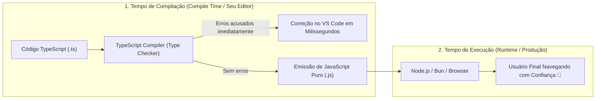

# 01: Por que TypeScript? (Runtime vs Compile Time)

> *"Esperar que os testes em produção descubram erros de tipagem é como desligar o detector de metais do aeroporto e torcer para a tripulação revistar cada passageiro em pleno voo."*

---

## 🧭 O Problema Fundamental do JavaScript

O JavaScript foi criado em 1995 por Brendan Eich em apenas 10 dias. Sua premissa original era simples: adicionar pequenos scripts interativos a páginas HTML estáticas. Por design, o JavaScript é uma linguagem de **tipagem dinâmica** e **fracamente tipada**.

Isso significa duas coisas críticas:
1. **Dinâmica**: As variáveis não possuem tipos fixos. Uma variável pode conter um número e, na linha seguinte, receber uma string ou um objeto.
2. **Fraca**: O interpretador tenta forçar coerções automáticas silenciosas sempre que encontra operações incompatíveis (ex: `[] + {}` resulta na string `"[object Object]"` em vez de lançar um erro).

Em aplicações empresariais modernas de dezenas ou centenas de milhares de linhas, essa maleabilidade transforma-se no temido pesadelo de produção:

```javascript
// JavaScript Puro: Erro silencioso que só explode em tempo de execução
function calculateInstallment(totalAmount, installmentsCount) {
  return totalAmount.toFixed(2) / installmentsCount;
}

calculateInstallment("1000", 2); 
// 💥 Uncaught TypeError: totalAmount.toFixed is not a function
```

Se essa chamada estiver dentro de uma rota de checkout acessada por 10.000 clientes às 3h da manhã, seu faturamento é interrompido até que alguém descubra a linha exata da falha.

---

## ⏱️ A Linha do Tempo: Compile Time vs Runtime

Para entender o poder do TypeScript, precisamos separar claramente as duas fases da vida de um software:



### 1. Tempo de Compilação (Compile Time)
É o momento em que o código está sendo escrito no seu editor ou verificado pelo comando `tsc`. Aqui, os tipos existem para guiar você, validar contratos e impedir que argumentos errados sejam enviados a funções.

### 2. Tempo de Execução (Runtime)
É o momento em que o Node.js, Bun ou o navegador executam as instruções. **Os tipos do TypeScript NÃO existem no Runtime!** Esse processo se chama **Type Erasure (Apagamento de Tipos)**. Todo o sistema de tipos é removido durante a compilação, gerando JavaScript puro ultrarrápido com zero overhead de memória ou CPU.

---

## 💡 A Analogia do Detector de Metais

Pense na segurança de um aeroporto:

* **O Modelo JavaScript (Sem TypeScript)**: Não há detector de metais na entrada. Qualquer pessoa embarca. Quando o avião atinge 10.000 metros de altitude, os comissários de bordo tentam abrir a mala de cada passageiro para conferir se há itens proibidos. Se houver algum problema, o avião cai.
* **O Modelo TypeScript**: Há um scanner de altíssima precisão na área de embarque. Se alguém tentar passar com uma ferramenta proibida (um argumento de tipo incorreto, uma propriedade inexistente ou `null` indesejado), o portão simplesmente **não abre**. O problema é resolvido no solo, antes de qualquer passageiro embarcar.

---

## 🔬 Comparativo Técnico Direto

Vejamos o mesmo cenário em JavaScript versus TypeScript:

### Em JavaScript Puro ❌

```javascript
// user-service.js
export function getUserFullName(user) {
  return `${user.firstName} ${user.lastName}`;
}

// Em outro arquivo, um colega chama a função passando uma propriedade errada:
getUserFullName({ first_name: "Christopher", surname: "Marques" });
// 💣 Retorna "undefined undefined" sem acusar NENHUM erro no console!
```

### Em TypeScript Estrito ✅

```typescript
// user-service.ts
export interface UserProfile {
  readonly firstName: string;
  readonly lastName: string;
}

export function getUserFullName(user: UserProfile): string {
  return `${user.firstName} ${user.lastName}`;
}

// Ao tentar passar o objeto com chaves diferentes:
getUserFullName({ first_name: "Christopher", surname: "Marques" });
// 🛑 ERRO IMEDIATO NO EDITOR:
// Argument of type '{ first_name: string; surname: string; }' is not assignable
// to parameter of type 'UserProfile'.
// Property 'firstName' is missing in type...
```

---

## 🛡️ A Importância do `"strict": true` em 2026

No início da história do TypeScript, muitas pessoas utilizavam o compilador no modo frouxo, permitindo inferências de `any` e ignorando a checagem de `null`. 

Em 2026, **isso é inadmissível**. Trabalhar sem a flag `"strict": true` anula 80% do valor do TypeScript. Com o strict mode ativado:
1. `null` e `undefined` são tipos distintos e não podem ser acessados sem verificação prévia (`strictNullChecks`).
2. O compilador impede o uso acidental do tipo permissivo `any` (`noImplicitAny`).
3. O `this` em funções é rigidamente inspecionado (`noImplicitThis`).
4. Propriedades de classes precisam ser inicializadas explicitamente no construtor (`strictPropertyInitialization`).

---

## 🧠 Resumo do Aprendizado

* JavaScript é dinâmico e flexível, mas perigoso em escala.
* TypeScript adiciona um **Sistema de Tipos Estrutural Estático** em tempo de desenvolvimento.
* No Runtime, o código executado é JavaScript puro: não há perda de desempenho nem peso extra no bundle final.
* Erros detectados no Compile Time custam centavos para consertar; erros detectados em Runtime custam a reputação do negócio.

