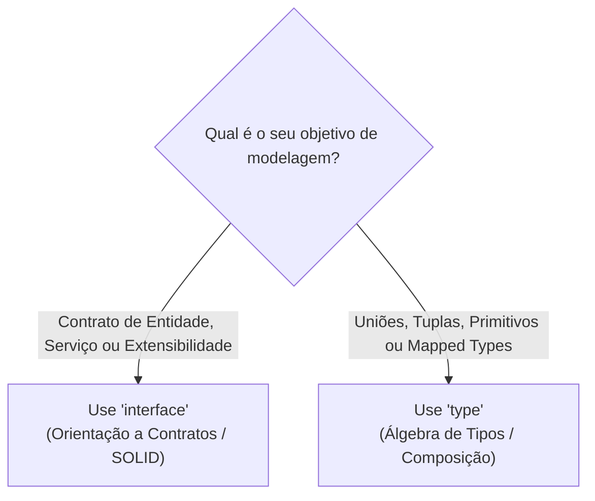
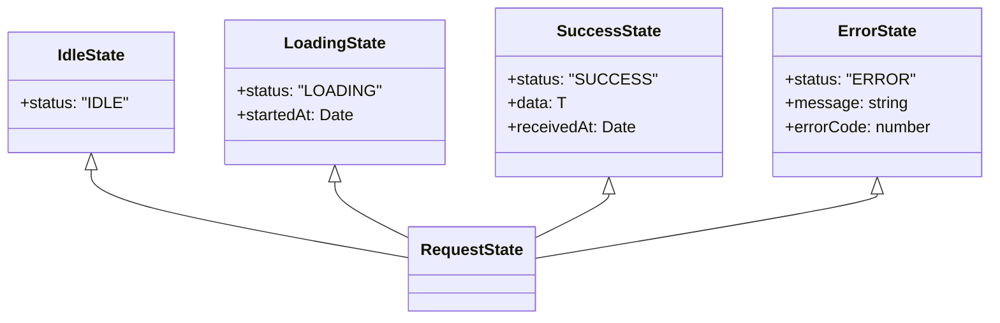

# 03: Interfaces, Types e Discriminated Unions

> *"A maior virtude de um sistema de tipos não é permitir estados válidos, mas tornar estados inválidos impossíveis de serem expressos em código."*

---

## 🥊 1. O Duelo: `interface` vs `type alias`

Tanto `interface` quanto `type` definem formas de objetos, mas possuem diferenças semânticas e arquiteturais fundamentais:



### Quando usar `interface`?
* Modelagem de contratos na Arquitetura Limpa (ex: `OrderRepository`, `NotificationService`).
* Objetos de domínio extensíveis via `extends`.
* **Declaration Merging** (extensão de tipos de bibliotecas de terceiros).

```typescript
export interface BaseEntity {
  readonly id: string;
  readonly createdAt: Date;
}

export interface Customer extends BaseEntity {
  readonly name: string;
  readonly email: string;
}
```

### Quando usar `type`?
* Para uniões (`A | B`), interseções (`A & B`), tuplas e primitivos.
* Para extração de utilitários e tipos mapeados.

```typescript
export type Identifier = string | number;
export type Coordinates = readonly [x: number, y: number];
export type Status = "draft" | "published" | "archived";
```

---

## 🚫 2. O Anti-Padrão das "Flags Booleanas Explosivas"

Observe como muitos programadores modelam o estado de uma requisição em JavaScript tradicional:

```typescript
// ❌ MODELAGEM RUIM (Permite estados absurdos em produção)
interface BadAsyncState {
  isLoading: boolean;
  isError: boolean;
  errorMessage: string | null;
  data: unknown | null;
}
```

O que acontece se `isLoading === true` E `isError === true` ao mesmo tempo? Ou se `data` existir, mas `isError` for `true`? 
Essa interface permite **16 combinações possíveis**, das quais apenas 4 fazem sentido no mundo real! O resto são estados zumbis que geram bugs de interface piscando na tela do usuário.

---

## 🎯 3. Tornando Estados Inválidos Impossíveis (Discriminated Unions)

A solução elegante e recomendada por arquitetos de software é o padrão **Discriminated Unions (Uniões Taggeadas ou Marcadas)**:



### Implementação em TypeScript:

```typescript
export interface IdleState {
  readonly status: "IDLE";
}

export interface LoadingState {
  readonly status: "LOADING";
  readonly startedAt: Date;
}

export interface SuccessState<TData> {
  readonly status: "SUCCESS";
  readonly data: TData;
  readonly receivedAt: Date;
}

export interface ErrorState {
  readonly status: "ERROR";
  readonly message: string;
  readonly errorCode: number;
}

export type RequestState<TData> =
  | IdleState
  | LoadingState
  | SuccessState<TData>
  | ErrorState;
```

---

## 🛡️ 4. Type Narrowing e Checagem Exaustiva (`assertNever`)

Quando consumimos uma união discriminada dentro de um bloco `switch`, o TypeScript estreita os tipos automaticamente. Além disso, podemos usar o tipo `never` para garantir em tempo de compilação que **nenhum caso foi esquecido**:

```typescript
export function assertNever(x: never): never {
  throw new Error(`Caso não tratado em tempo de compilação: ${JSON.stringify(x)}`);
}

export function handleRequestState<T>(state: RequestState<T>): string {
  switch (state.status) {
    case "IDLE":
      return "Pronto para iniciar.";
    case "LOADING":
      return `Carregando iniciado em ${state.startedAt.toLocaleTimeString()}...`;
    case "SUCCESS":
      // O TypeScript SABE que 'state.data' e 'state.receivedAt' existem aqui com 100% de certeza!
      return `Concluído: ${JSON.stringify(state.data)}`;
    case "ERROR":
      // O TypeScript SABE que 'state.message' e 'state.errorCode' existem aqui!
      return `Falha ${state.errorCode}: ${state.message}`;
    default:
      // Se amanhã alguém adicionar um estado "CANCELLED" em RequestState e esquecer
      // de criar um case para ele aqui, o TypeScript recusará compilar na linha abaixo!
      return assertNever(state);
  }
}
```

---

## 🔬 5. Interseções de Tipos (`&`)

Enquanto a União (`|`) representa "OU" (um dos tipos), a Interseção (`&`) representa "E" (a união de todas as propriedades):

```typescript
export interface HasTimestamp {
  readonly createdAt: Date;
  readonly updatedAt: Date;
}

export interface HasIdentity {
  readonly id: string;
}

export interface OrderPayload {
  readonly total: number;
  readonly customerEmail: string;
}

// Compondo um tipo completo a partir de peças menores e reutilizáveis (ISP do SOLID):
export type PersistedOrder = HasIdentity & HasTimestamp & OrderPayload;

const databaseRecord: PersistedOrder = {
  id: "ord_123",
  total: 450.0,
  customerEmail: "maria@example.com",
  createdAt: new Date(),
  updatedAt: new Date(),
};
```

---

## 🏆 Regra Prática de Engenharia

Sempre que você estiver prestes a criar múltiplos campos booleanos em uma interface (`isPending`, `isCompleted`, `isFailed`, `isRefunded`), pare imediatamente e modele como uma **Discriminated Union**. O seu código futuro agradecerá!

