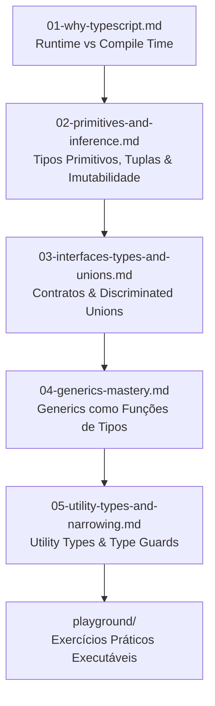

# 🏛️ Módulo 01: Fundamentos de TypeScript & Tipagem Estrita

> **"Tipos não são restrições burocráticas; são garantias matemáticas de que seu software faz o que promete."**

Bem-vindo ao primeiro módulo do **TypeScript Hub**! Este módulo foi concebido para transformar qualquer pessoa desenvolvedora — quer venha do JavaScript puro, de Python ou de linguagens orientadas a objetos como C# e Java — em alguém fluente nas engrenagens fundamentais do sistema de tipos estrutural do TypeScript.

---

## 🎯 Mapa de Aprendizado do Módulo



---

## 🌐 Por que Codamos 100% em Inglês no Mercado de Tecnologia?

Uma das regras de ouro deste repositório e da indústria de software em 2026 é: **todo identificador em código deve ser escrito em Inglês técnico**. Por que não misturamos variáveis em português com código?

1. **Interoperabilidade com o Ecossistema Global**:
   Todas as APIs nativas do JavaScript e da Web (`Array.prototype.map`, `document.addEventListener`, `fetch()`, `JSON.stringify`) são em inglês. Quando misturamos idiomas, geramos monstruosidades semânticas como:
   ```typescript
   // ❌ Anti-padrão: Mistura de idiomas (Spanglish/Portuglês)
   const pedido = listaDePedidos.find((p) => p.isAtivo());
   ```
   Em contrapartida, manter consistência no idioma nativo da plataforma cria um fluxo de leitura uniforme:
   ```typescript
   // ✅ Padrão Profissional: 100% em Inglês
   const activeOrder = orderList.find((order) => order.isActive());
   ```

2. **Adoção e Compartilhamento Open-Source**:
   Se você criar uma biblioteca fantástica e quiser publicá-la no NPM ou receber contribuições no GitHub, programadores do Japão, Alemanha, Índia ou Canadá só conseguirão ler, testar e contribuir se os nomes forem em inglês.

3. **Compatibilidade com Ferramentas de AI e Análise Estática**:
   Linters, formatadores, analisadores de segurança (SAST) e modelos de linguagem modernos de IA possuem um vocabulário imensamente mais calibrado e assertivo quando operam com tokens em inglês.

4. **Mercado e Carreira Internacional**:
   As melhores oportunidades profissionais em 2026 conectam times remotos distribuídos pelo mundo. Adotar inglês no código desde o primeiro dia elimina o atrito de tradução e prepara seu portfólio para empresas globais.

---

## 📂 Conteúdo Detalhado das Aulas

| Arquivo | Tópicos Centrais | Nível |
| :--- | :--- | :--- |
| **[`01-why-typescript.md`](./01-why-typescript.md)** | Runtime vs Compile Time, Soundness, Analogia do Detector de Metal. | Iniciante |
| **[`02-primitives-and-inference.md`](./02-primitives-and-inference.md)** | `string`, `number`, `boolean`, `readonly`, Tuplas, `as const`. | Iniciante |
| **[`03-interfaces-types-and-unions.md`](./03-interfaces-types-and-unions.md)** | `interface` vs `type`, Discriminated Unions, Estados Impossíveis. | Intermediário |
| **[`04-generics-mastery.md`](./04-generics-mastery.md)** | Parâmetros de tipo `<T>`, Restrições (`extends`), Inferência avançada. | Avançado |
| **[`05-utility-types-and-narrowing.md`](./05-utility-types-and-narrowing.md)** | `Partial`, `Pick`, `Omit`, `Record`, `ReturnType`, Type Predicates (`is`). | Avançado |

---

## 🧪 Prática Executável no Terminal

Não fique só na teoria! Entre no terminal e execute os playgrounds interativos deste módulo:

```bash
# Executar aula prática de primitivos, tuplas e const assertions
npm run play:basics

# Executar laboratório de Generics (inspirado no sawabona-forms)
npm run play:generics

# Executar máquina de estados com Uniões Discriminadas (inspirado no sawabona-motion-engine)
npm run play:unions
```

