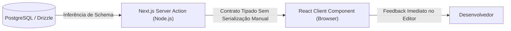

# 01: Web Frontend e Arquiteturas Full-Stack

> *"O Santo Graal da engenharia web é a Tipagem End-to-End: alterar uma coluna no banco de dados e ver o compilador avisar exatamente qual componente na interface do usuário precisa ser ajustado."*

---

## 🌐 1. O Cenário Web em 2026: Do SPA ao Full-Stack Unificado

Até alguns anos atrás, o ecossistema frontend operava em silos:
* Um backend em Node ou Go expondo rotas REST.
* Um frontend em React/Vue consumindo endpoints via `fetch()` ou `axios`.
* A necessidade de escrever documentações Swagger ou gerar clientes manualmente para não perder a sincronia dos tipos.

Com **React 19**, **Next.js (App Router)** e **Server Actions**, o TypeScript eliminou essa barreira. Hoje podemos criar aplicações Full-Stack com **Tipagem End-to-End (E2E Type Safety)** sem precisar escrever uma única linha de `fetch` manual.



---

## ⚡ 2. Tipagem de Componentes React Modernos

No React com TypeScript, evitamos tipar `props` com tipos frouxos ou usar `React.FC` antigo. O padrão atual é declarar interfaces explícitas e desestruturar diretamente nos parâmetros da função:

```typescript
// Componente de Cartão de Produto Totalmente Tipado
export interface ProductCardProps {
  readonly id: string;
  readonly title: string;
  readonly priceInCents: number;
  readonly inStock: boolean;
  readonly onAddToCart: (productId: string) => Promise<void>;
}

export function ProductCard({
  id,
  title,
  priceInCents,
  inStock,
  onAddToCart,
}: ProductCardProps) {
  const formattedPrice = (priceInCents / 100).toLocaleString("pt-BR", {
    style: "currency",
    currency: "BRL",
  });

  return (
    <article className="rounded-xl border border-neutral-800 p-6 bg-neutral-900">
      <h3 className="text-lg font-semibold text-white">{title}</h3>
      <p className="text-neutral-400 mt-1">{formattedPrice}</p>
      
      <button
        disabled={!inStock}
        onClick={() => onAddToCart(id)}
        className="mt-4 px-4 py-2 bg-blue-600 hover:bg-blue-500 disabled:bg-neutral-800 text-white rounded-lg font-medium transition"
      >
        {inStock ? "Adicionar ao Carrinho" : "Esgotado"}
      </button>
    </article>
  );
}
```

---

## 🚀 3. Server Actions e Tipagem com o Caso `saas-boilerplate`

No repositório de referência **[`saas-boilerplate`](https://github.com/ChristopherMarques/saas-boilerplate)**, Server Actions são usadas para orquestrar operações de backend de forma segura, gerenciando tenants e permissões:

```typescript
"use server";

import { z } from "zod";

// 1. Schema de validação em Runtime
const CreateTenantSchema = z.object({
  organizationName: z.string().min(3, "Nome da organização deve ter no mínimo 3 caracteres"),
  subdomain: z.string().regex(/^[a-z0-9-]+$/, "Subdomínio deve conter apenas letras minúsculas e hífens"),
  adminEmail: z.string().email("E-mail corporativo inválido"),
});

// 2. Tipo estático inferido automaticamente do schema Zod!
export type CreateTenantInput = z.infer<typeof CreateTenantSchema>;

export type ServerActionResult<TData> =
  | { readonly success: true; readonly data: TData }
  | { readonly success: false; readonly errorMessage: string };

// 3. Server Action tipada que executa no servidor
export async function createTenantAction(
  rawInput: CreateTenantInput
): Promise<ServerActionResult<{ tenantId: string; redirectUrl: string }>> {
  // Validação segura no servidor
  const parseResult = CreateTenantSchema.safeParse(rawInput);
  if (!parseResult.success) {
    return {
      success: false,
      errorMessage: parseResult.error.issues[0]?.message ?? "Dados inválidos.",
    };
  }

  const { organizationName, subdomain } = parseResult.data;

  // Lógica de persistência em multi-tenancy (Clean Architecture)
  const tenantId = `tenant_${Math.random().toString(36).substring(2, 9)}`;

  return {
    success: true,
    data: {
      tenantId,
      redirectUrl: `https://${subdomain}.saas.domain.com/dashboard`,
    },
  };
}
```

---

## 🛡️ 4. Por que isso muda as regras do jogo?

1. **Zero Divergência**: Se você renomear `organizationName` para `companyName` no backend, o TypeScript emitirá um erro vermelho imediatamente nos inputs do seu formulário frontend antes mesmo do commit.
2. **Auto-Complete Completo**: O editor sugere exatamente os campos esperados pela ação do servidor.
3. **Segurança Reforçada**: A validação acontece tanto no cliente (para UX instantânea) quanto no servidor (para integridade de dados).

