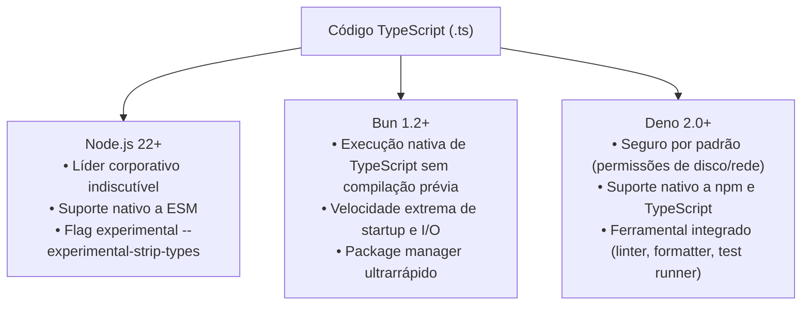

# 02: Backend APIs, Runtimes e Bancos de Dados

> *"No backend, TypeScript transforma código de infraestrutura e persistência em contratos matematicamente verificáveis, eliminando descompassos de banco de dados e APIs corrompidas."*

---

## ⚙️ 1. A Batalha dos Runtimes em 2026

Atualmente, temos três grandes runtimes para executar TypeScript no servidor:



---

## 🚀 2. Frameworks de Alta Performance: Fastify & NestJS

### Fastify: Desempenho e Tipagem com Schemas
O Fastify é um dos servidores HTTP mais rápidos do mundo para Node.js. Combinado com TypeScript e Type Provider, ele infere tipos de rota a partir de esquemas JSON/Zod:

```typescript
import Fastify from "fastify";
import { z } from "zod";

const server = Fastify({ logger: true });

// Schema da requisição
const CreateUserBodySchema = z.object({
  email: z.string().email(),
  fullName: z.string().min(2),
});

type CreateUserBody = z.infer<typeof CreateUserBodySchema>;

// Rota estritamente tipada
server.post<{ Body: CreateUserBody }>(
  "/api/users",
  async (request, reply) => {
    // request.body é inferido com 100% de precisão!
    const { email, fullName } = request.body;

    return reply.status(201).send({
      id: `usr_${Date.now()}`,
      email,
      fullName,
      status: "active",
    });
  }
);
```

### NestJS: Arquitetura Empresarial Orientada a Injeção de Dependências
Para grandes empresas, o NestJS aplica conceitos clássicos de Orientação a Objetos e Injeção de Dependências inspirados no ecossistema Spring Boot/Angular.

---

## 🗄️ 3. O Dilema dos ORMs: Prisma vs Drizzle ORM

No acesso a bancos relacionais (PostgreSQL, MySQL, SQLite), a indústria em 2026 migrou fortemente para ORMs "type-first":

| Característica | Prisma ORM | Drizzle ORM |
| :--- | :--- | :--- |
| **Abordagem** | Schema DSL próprio (`schema.prisma`) gerando types | Definição de tabelas diretamente em TypeScript puro |
| **Overhead de Runtime** | Query Engine binária em Rust | Praticamente zero overhead (apenas construtor SQL) |
| **Inferência de Tipos** | Gera arquivos `.d.ts` pós-geração | Inferência instantânea em tempo real no código |
| **Controle de SQL** | Camada alta de abstração | Proximidade total com comandos SQL padrão |

### Exemplo com Drizzle ORM (TypeScript Puro):

```typescript
import { pgTable, text, timestamp, integer } from "drizzle-orm/pg-core";
import { InferSelectModel, InferInsertModel } from "drizzle-orm";

// 1. Definição da tabela diretamente em TypeScript
export const ordersTable = pgTable("orders", {
  id: text("id").primaryKey(),
  customerEmail: text("customer_email").notNull(),
  totalAmountInCents: integer("total_amount_in_cents").notNull(),
  createdAt: timestamp("created_at").defaultNow().notNull(),
});

// 2. Extração mágica dos tipos de Leitura e Inserção:
export type OrderRecord = InferSelectModel<typeof ordersTable>;
export type NewOrderRecord = InferInsertModel<typeof ordersTable>;
```

---

## 🛡️ 4. Validação em Runtime: A Ponte com Zod

Lembre-se: **O TypeScript só existe em tempo de compilação**. Quando uma requisição HTTP chega ao seu servidor, ela é apenas texto JSON cru. 

Para proteger as fronteiras do sistema contra dados maliciosos ou corrompidos, usamos bibliotecas como **Zod**:

```typescript
import { z } from "zod";

// Schema de Variáveis de Ambiente
export const EnvironmentVariablesSchema = z.object({
  NODE_ENV: z.enum(["development", "test", "production"]).default("development"),
  PORT: z.coerce.number().default(3000),
  DATABASE_URL: z.string().url("A URL do banco de dados deve ser válida"),
  JWT_SECRET: z.string().min(32, "O secret do JWT deve ter no mínimo 32 caracteres"),
});

// Validação ao iniciar o servidor:
export function loadEnvConfig() {
  const parsed = EnvironmentVariablesSchema.safeParse(process.env);
  if (!parsed.success) {
    console.error("❌ Variáveis de ambiente inválidas:", parsed.error.format());
    process.exit(1);
  }
  return parsed.data; // Retorna um objeto fortemente tipado e garantido!
}
```

---

## 🏁 Conclusão

Com TypeScript no backend:
1. Suas queries de banco de dados não contêm erros de digitação em nomes de colunas.
2. Suas variáveis de ambiente são validadas na inicialização do container.
3. Seus controllers HTTP rejeitam payloads malformados antes que eles toquem as regras de negócio do Domínio.

