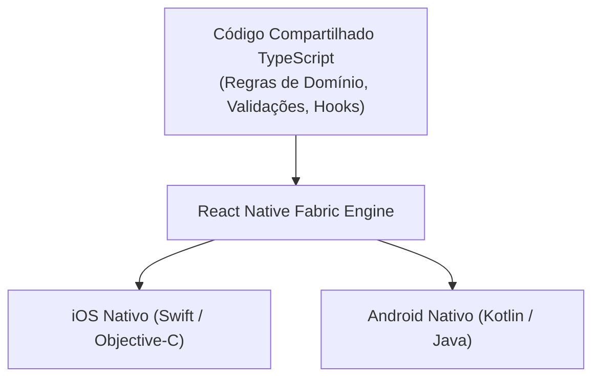

# 03: Aplicações Mobile e Desktop com TypeScript

> *"O sonho do 'Write Once, Run Anywhere' só se tornou verdadeiramente produtivo quando o TypeScript trouxe contratos de tipo para orquestrar pontes nativas no iOS, Android, Windows, macOS e Linux."*

---

## 📱 1. O Mundo Mobile: React Native & Expo

No desenvolvimento de aplicativos para smartphones, o ecossistema React Native com **Expo** domina grande parte dos lançamentos de startups e corporações globais em 2026.



### Navegação Estritamente Tipada (Expo Router)
Com rotas baseadas em sistema de arquivos, o TypeScript consegue validar links de navegação para que o aplicativo nunca tente navegar para uma tela inexistente:

```typescript
import { Link } from "expo-router";

export function ProfileButton({ userId }: { readonly userId: string }) {
  return (
    // O TypeScript valida a rota estaticamente:
    <Link href={`/users/${userId}/settings`} asChild>
      <button className="p-3 bg-neutral-800 rounded-lg text-white">
        Acessar Configurações
      </button>
    </Link>
  );
}
```

---

## 💻 2. Aplicações Desktop: Electron vs Tauri 2.0

O software onde você provavelmente está lendo ou escrevendo este código agora — o **Visual Studio Code** — é uma aplicação desktop escrita em TypeScript rodando sobre o **Electron**.

| Dimensão | Electron | Tauri 2.0 |
| :--- | :--- | :--- |
| **Arquitetura** | Chromium Embutido + Node.js | WebView Nativo do SO + Core em Rust |
| **Consumo de Memória** | Médio a Alto (~150MB+ inicial) | Mínimo (~30MB inicial) |
| **Tamanho do Instalador** | ~80MB a 120MB | ~5MB a 15MB |
| **Comunicação IPC** | Tipada via ContextBridge no Preload | Comandos Tipados entre Rust e TypeScript |
| **Casos Notórios** | VS Code, Slack, Discord, Obsidian | Novas aplicações desktop ultraleves |

### Comunicação IPC Segura e Tipada no Electron:

```typescript
// preload.ts (Contrato seguro exposto ao frontend)
import { contextBridge, ipcRenderer } from "electron";

export interface DesktopApiContract {
  openFileDialog: () => Promise<string | null>;
  saveReport: (content: string) => Promise<{ success: boolean; path: string }>;
}

const desktopApi: DesktopApiContract = {
  openFileDialog: () => ipcRenderer.invoke("dialog:openFile"),
  saveReport: (content: string) => ipcRenderer.invoke("report:save", content),
};

// Expõe para a janela do navegador de forma isolada
contextBridge.exposeInMainWorld("desktopApi", desktopApi);
```

---

## 🔄 3. O Poder do Monorepo: Compartilhamento de Domínio

O maior trunfo de usar TypeScript em toda a stack é a capacidade de estruturar um **Monorepo** (com Turborepo, Nx ou pnpm workspaces):

```text
meu-ecossistema/
├── packages/
│   ├── core-domain/          # Entidades (Product, Order), Regras de Domínio e Validações
│   └── ui-kit/               # Componentes visuais reutilizáveis
└── apps/
    ├── web-portal/           # Next.js App
    ├── mobile-app/           # React Native / Expo
    ├── desktop-admin/        # Tauri / Electron
    └── backend-api/          # Fastify / Node.js
```

Quando a regra de cálculo de frete ou validação de CPF/CNPJ muda, ela é alterada em um único lugar (`packages/core-domain`) e todos os clientes — web, celular e desktop — atualizam instantaneamente com 100% de coerência tipada.

