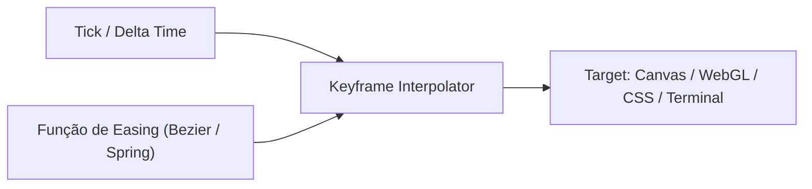
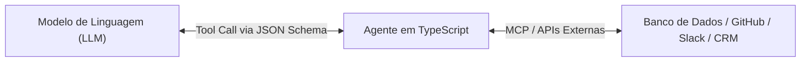

# 04: Motores Gráficos, Motion, CLIs e Agentes de IA

> *"TypeScript não para nas janelas de aplicativos tradicionais: ele dá vida a timelines de animação matemática, alimenta ferramentas de linha de comando no terminal e serve como o cérebro condutor de ferramentas para Inteligência Artificial."*

---

## 🎮 1. Motores Gráficos e o Caso `sawabona-motion-engine`

Na criação de animações e jogos, a performance de 60 ou 120 FPS depende de laços de repetição puros (`requestAnimationFrame`), cálculos vetoriais e **zero alocação indevida de lixo na memória (Garbage Collection)**.

No repositório de referência **[`sawabona-motion-engine`](https://github.com/ChristopherMarques/sawabona-motion-engine)**, o TypeScript é utilizado para:
1. Definir contratos estritos para curvas de interpolação e funções de easing.
2. Garantir através de interfaces que qualquer objeto animável possua propriedades compatíveis (`x`, `y`, `opacity`, `scale`).
3. Construir transições de estado limpas sem vazamento de memória.



### Exemplo de Curva de Easing Matemática Pura:

```typescript
// Contrato de função de amortecimento (Easing)
export type EasingFunction = (timeFraction: number) => number;

// Implementações puras e previsíveis:
export const MotionCurves: Record<string, EasingFunction> = {
  linear: (t) => t,
  easeInQuad: (t) => t * t,
  easeOutBounce: (t) => {
    const n1 = 7.5625;
    const d1 = 2.75;
    if (t < 1 / d1) {
      return n1 * t * t;
    } else if (t < 2 / d1) {
      const adjusted = t - 1.5 / d1;
      return n1 * adjusted * adjusted + 0.75;
    } else if (t < 2.5 / d1) {
      const adjusted = t - 2.25 / d1;
      return n1 * adjusted * adjusted + 0.9375;
    } else {
      const adjusted = t - 2.625 / d1;
      return n1 * adjusted * adjusted + 0.984375;
    }
  },
};
```

---

## ⌨️ 2. Ferramentas de Linha de Comando (CLIs) Modernas

Desenvolver ferramentas CLI em TypeScript proporciona uma experiência de engenharia rica:
* **Commander.js**: Para definição de comandos, flags e argumentos tipados.
* **Inquirer / Clack**: Para prompts interativos e acolhedores no terminal.
* **Ink**: Para renderizar interfaces React completas diretamente dentro do terminal do console!

```typescript
// Exemplo de comando CLI tipado:
import { Command } from "commander";

const program = new Command();

interface DeployCommandOptions {
  readonly stage: "dev" | "staging" | "prod";
  readonly dryRun?: boolean;
}

program
  .command("deploy")
  .description("Publica uma nova versão do serviço na nuvem")
  .requiredOption("-s, --stage <stage>", "Ambiente de destino (dev, staging, prod)")
  .option("--dry-run", "Executa a simulação sem alterar recursos reais")
  .action((options: DeployCommandOptions) => {
    console.log(`🚀 Iniciando deploy no ambiente: ${options.stage}`);
    if (options.dryRun) {
      console.log("🔍 Modo Dry-Run ativado: nenhuma alteração será persistida.");
    }
  });
```

---

## 🤖 3. Agentes de IA, Model Context Protocol (MCP) e Tool Calling

Em 2026, TypeScript se tornou a linguagem número 1 para orquestração de **Agentes Autônomos de Inteligência Artificial**. 

Por quê? Porque os Grandes Modelos de Linguagem (LLMs) recebem definições de ferramentas (`tools`) através de esquemas **JSON Schema** — e bibliotecas como **Zod** geram JSON Schema diretamente a partir de tipos TypeScript!



### Definindo uma Ferramenta de Agente de IA com TypeScript e Zod:

```typescript
import { z } from "zod";

export const CreateIssueToolParameters = z.object({
  title: z.string().describe("Título claro e resumido da issue"),
  severity: z.enum(["low", "medium", "critical"]).describe("Nível de severidade do bug"),
  reproductionSteps: z.array(z.string()).describe("Passos para reproduzir o problema"),
});

export type CreateIssueInput = z.infer<typeof CreateIssueToolParameters>;

export async function executeCreateIssue(input: CreateIssueInput): Promise<string> {
  // O LLM preenche o JSON e o TypeScript garante que todos os campos estão corretos!
  console.log(`[AI Agent] Criando issue de severidade '${input.severity}': ${input.title}`);
  return `Issue registrada com sucesso para ${input.reproductionSteps.length} passos descritos.`;
}
```

---

## 🏁 Síntese

O TypeScript domina todas as dimensões da engenharia de software atual:
* **No Frontend**: interfaces vivas e previsíveis.
* **No Backend**: persistência e APIs imutáveis.
* **No Mobile & Desktop**: aplicativos universais em um único monorepo.
* **Em Engines & IA**: precisão matemática, ferramentas interativas e integração com agentes inteligentes.

