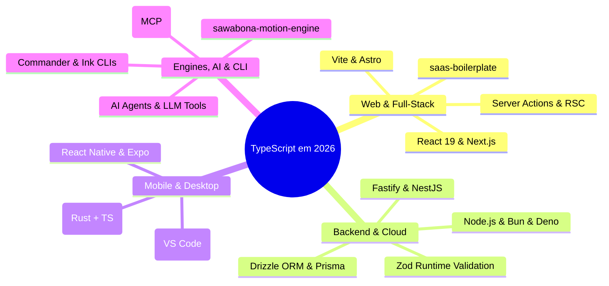

# 🌐 Módulo 02: Ecossistema e Plataformas (Visão 360º em 2026)

> **"Qualquer aplicação que possa ser escrita em JavaScript, eventualmente será escrita em TypeScript."** — *Lei de Atwood (Versão Moderna)*

Em 2026, o TypeScript não é apenas uma ferramenta de navegadores web: ele se tornou a **língua franca universal da computação moderna**, executando desde microsserviços de alta performance e CLIs distribuídas até jogos, agentes de Inteligência Artificial e sistemas desktop nativos.

---

## 🗺️ Onde o TypeScript Opera Hoje?

---

## 📚 Aulas Deste Módulo

| Arquivo | Domínio Tecnológico | Principais Tecnologias e Padrões |
| :--- | :--- | :--- |
| **[`01-web-frontend-and-fullstack.md`](./01-web-frontend-and-fullstack.md)** | Web & Full-Stack Moderno | React 19, Server Components, Next.js App Router, Server Actions, Tipagem End-to-End (*saas-boilerplate*). |
| **[`02-backend-apis-and-databases.md`](./02-backend-apis-and-databases.md)** | Back-end de Alta Escala | Node 22+, Bun, Deno, Fastify, NestJS, Prisma, Drizzle ORM, Validação em Runtime com Zod. |
| **[`03-mobile-and-desktop.md`](./03-mobile-and-desktop.md)** | Mobile & Desktop | React Native com Expo (iOS/Android), Electron (como o VS Code é feito), Tauri 2.0. |
| **[`04-games-motion-cli-and-ai.md`](./04-games-motion-cli-and-ai.md)** | Engines, Animação, CLIs & AI | Motores gráficos e matemáticos (*sawabona-motion-engine*), CLIs com Ink/Commander, Agentes de IA e MCP. |

---

## 🎯 Objetivo Pedagógico

Ao concluir este módulo, você deixará de enxergar o TypeScript como uma mera extensão de sintaxe e passará a vê-lo como uma **vantagem competitiva arquitetural**, capaz de compartilhar contratos de domínio entre o backend, o frontend, o app mobile e ferramentas de automação.

