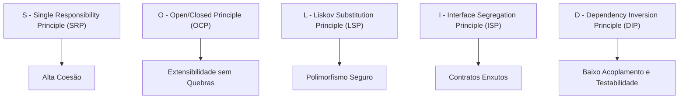
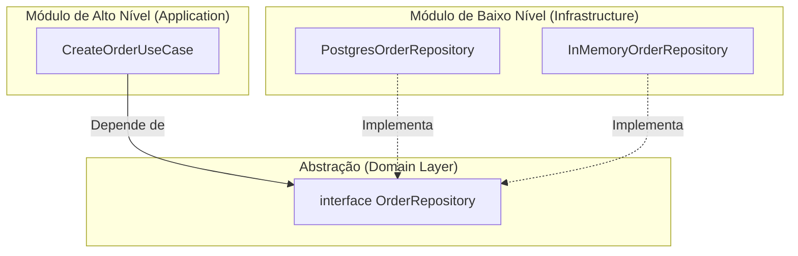

# 02: Mergulho Profundo nos Princípios S.O.L.I.D.

> *"Os princípios SOLID não são regras para engessar o desenvolvedor, mas ferramentas de sobrevivência para manter sistemas saudáveis e extensíveis sob constante mudança de requisitos."*

---

## 🧭 O que é o S.O.L.I.D.?

O acrônimo SOLID reúne cinco princípios de design de software compilados por Robert C. Martin (Uncle Bob):



---

## 1. S — Single Responsibility Principle (SRP)

> *"Uma classe ou módulo deve ter um, e apenas um, motivo para mudar."*

### Cenário Ruim (God Class com Múltiplos Motivos para Mudar) ❌
Uma classe que calcula imposto, formata para PDF e envia e-mail muda quando:
1. As leis fiscais mudam.
2. O layout do PDF é atualizado.
3. O provedor de e-mail (SendGrid/SES) é trocado.

```typescript
// ❌ Ruim: Três responsabilidades misturadas
class InvoiceGodClass {
  public calculateTotal(): number { /* regra fiscal */ return 100; }
  public printToPdf(): void { /* lógica de canvas/pdf */ }
  public sendEmail(to: string): void { /* conexão SMTP */ }
}
```

### Cenário Limpo com SRP ✅
Divida as responsabilidades entre Domínio, Apresentação e Infraestrutura:

```typescript
// ✅ 1. Domínio Puro: Responsável apenas pelas regras fiscais
export class Invoice {
  constructor(public readonly amount: number, public readonly taxRate: number) {}
  public calculateTotal(): number {
    return this.amount + this.amount * this.taxRate;
  }
}

// ✅ 2. Apresentação: Responsável apenas pela formatação visual
export class InvoicePdfRenderer {
  public render(invoice: Invoice): string {
    return `<pdf>Total: R$ ${invoice.calculateTotal()}</pdf>`;
  }
}

// ✅ 3. Infraestrutura: Responsável apenas pela entrega da mensagem
export interface EmailSender {
  send(to: string, content: string): Promise<void>;
}
```

---

## 2. O — Open/Closed Principle (OCP)

> *"Entidades de software devem estar abertas para extensão, mas fechadas para modificação."*

Você deve ser capaz de adicionar um novo comportamento ao sistema sem alterar o código existente que já está testado e rodando em produção.

### Cenário Ruim (Switch/Case Infinito) ❌

```typescript
// ❌ Ruim: Toda vez que surge uma nova promoção, este arquivo precisa ser modificado
class DiscountCalculator {
  public applyDiscount(type: string, amount: number): number {
    if (type === "BLACK_FRIDAY") return amount * 0.8;
    if (type === "NATAL") return amount * 0.9;
    if (type === "ANIVERSARIO") return amount * 0.85;
    return amount;
  }
}
```

### Cenário Limpo com Strategy Pattern ✅

```typescript
// ✅ Definimos um contrato aberto para extensão:
export interface DiscountStrategy {
  calculate(amount: number): number;
}

export class BlackFridayDiscount implements DiscountStrategy {
  public calculate(amount: number): number {
    return amount * 0.8; // 20% OFF
  }
}

export class ChristmasDiscount implements DiscountStrategy {
  public calculate(amount: number): number {
    return amount * 0.9; // 10% OFF
  }
}

// Se amanhã surgir "CyberMondayDiscount", criamos uma nova classe SEM TOCAR em nenhuma anterior!
export class OrderPricer {
  public calculateTotal(amount: number, strategy: DiscountStrategy): number {
    return strategy.calculate(amount);
  }
}
```

---

## 3. L — Liskov Substitution Principle (LSP)

> *"Se $S$ é um subtipo de $T$, então objetos do tipo $T$ devem poder ser substituídos por objetos do tipo $S$ sem quebrar o programa."* — *Barbara Liskov*

Subclasses ou implementações concretas nunca devem enfraquecer pré-condições, alterar comportamentos esperados ou lançar exceções inesperadas para métodos da interface base.

### O Clássico Exemplo do Pássaro Avestruz ❌

```typescript
// ❌ Ruim: Nem todo pássaro voa!
class Bird {
  public fly(): void {
    console.log("Voando alto...");
  }
}

class Ostrich extends Bird {
  public override fly(): void {
    // 💥 Quebra o LSP: O avestruz lança um erro em runtime onde o cliente esperava voo!
    throw new Error("Avestruzes não voam!");
  }
}
```

### Respeitando o LSP com Segregação Correta ✅

```typescript
export interface Bird {
  layEgg(): void;
}

export interface FlyingBird extends Bird {
  fly(): void;
}

export class Sparrow implements FlyingBird {
  public layEgg(): void { console.log("Botando ovo..."); }
  public fly(): void { console.log("Pardal voando!"); }
}

export class Ostrich implements Bird {
  public layEgg(): void { console.log("Avestruz botando ovo grande..."); }
  // Não implementa FlyingBird, mantendo os contratos 100% íntegros!
}
```

---

## 4. I — Interface Segregation Principle (ISP)

> *"Muitas interfaces específicas são melhores do que uma única interface genérica ('gorda')."*

Clientes não devem ser forçados a depender de métodos que não utilizam.

### Cenário Ruim (Interface Gorda) ❌

```typescript
// ❌ Ruim: Força um simples leitor de dados a implementar métodos de escrita e backup
interface DataStore {
  read(id: string): string;
  write(id: string, data: string): void;
  createSnapshotBackup(): void;
}
```

### Cenário Limpo com Contratos Focados e Interseção ✅

```typescript
// ✅ Interfaces enxutas e focadas:
export interface Reader<T> {
  read(id: string): Promise<T | null>;
}

export interface Writer<T> {
  write(id: string, data: T): Promise<void>;
}

export interface Snapshotable {
  createSnapshot(): Promise<string>;
}

// Uma classe de relatório consome apenas o que precisa:
export class AnalyticsReporter<T> {
  constructor(private readonly reader: Reader<T>) {}
  // Não tem acesso a 'write' nem a 'createSnapshot' — menos superfície de erro!
}
```

---

## 5. D — Dependency Inversion Principle (DIP)

> *"Módulos de alto nível não devem depender de módulos de baixo nível. Ambos devem depender de abstrações. Abstrações não devem depender de detalhes. Detalhes devem depender de abstrações."*

O Caso de Uso do seu sistema (alto nível) jamais deve importar o `PrismaClient`, o `pg` ou o `Axios` diretamente. Ele define uma `interface` de repositório no Domínio, e a infraestrutura implementa esse contrato.



### Implementação em TypeScript:

```typescript
// 1. O Contrato (no Domínio):
export interface OrderRepository {
  save(orderId: string, amount: number): Promise<void>;
}

// 2. O Caso de Uso (no Application) recebe a abstração via construtor (Injeção de Dependência):
export class CreateOrderUseCase {
  constructor(private readonly orderRepository: OrderRepository) {}

  public async execute(orderId: string, amount: number): Promise<void> {
    // Regra de aplicação...
    await this.orderRepository.save(orderId, amount);
  }
}

// 3. Na Infraestrutura:
export class PostgresOrderRepository implements OrderRepository {
  public async save(orderId: string, amount: number): Promise<void> {
    console.log(`[SQL Postgres] INSERT INTO orders VALUES (${orderId}, ${amount})`);
  }
}
```

Isso permite testar o `CreateOrderUseCase` instantaneamente em milissegundos passando um repositório falso em memória, sem precisar subir nenhum container Docker de banco de dados!

