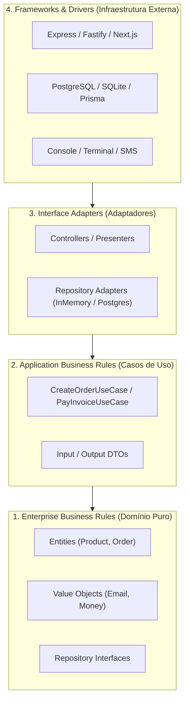

# 03: Clean Architecture e Domain-Driven Design (DDD)

> *"A arquitetura de um sistema deve gritar o seu propósito de negócio, e não os frameworks ou bibliotecas que ele utiliza."* — *Robert C. Martin*

---

## 🏛️ 1. O Diagrama Sagrado da Clean Architecture

A **Clean Architecture** (Arquitetura Limpa) organiza o código em camadas concêntricas regidas por uma regra de ouro imutável: **The Dependency Rule (A Regra da Dependência)**.

> **Regra da Dependência**: As dependências do código-fonte só podem apontar **para dentro**, em direção às políticas de alto nível (Domínio). Nada na camada interna pode saber o que existe na camada externa.



---

## 🧱 2. As Quatro Camadas Explicadas

### 1. Domínio (Domain / Enterprise Business Rules)
* **O que é**: O coração imutável do negócio.
* **O que contém**: Entidades ricas, Value Objects, interfaces de repositórios e erros de domínio.
* **Regra Fundamental**: Zero dependências externas! Não importa se existe internet, se o banco é SQL ou NoSQL, ou qual biblioteca está na moda. Se todo o resto for deletado, o domínio continua compilando perfeitamente.

### 2. Aplicação (Application / Use Cases)
* **O que é**: Orquestra o fluxo de dados para cumprir tarefas operacionais do sistema.
* **O que contém**: Casos de Uso (`CreateOrderUseCase`), DTOs e contratos de serviços auxiliares.
* **Responsabilidade**: Recebe os dados, valida o fluxo com o Domínio e manda salvar através de abstrações.

### 3. Adaptadores (Interface Adapters)
* **O que é**: Converte os dados entre o formato mais conveniente para o Domínio/Casos de Uso e o formato externo.
* **O que contém**: Implementações concretas de Repositórios (`InMemoryOrderRepository`), Controllers HTTP, Mappers e Notificadores de e-mail.

### 4. Frameworks & Drivers
* **O que é**: Detalhes descartáveis de infraestrutura.
* **O que contém**: Fastify, Next.js, Prisma, AWS SDK, scripts de inicialização (`main.ts`).

---

## 🧠 3. Entidades Ricas vs Modelos Anêmicos (O Perigo do Anemic Domain Model)

Martin Fowler alerta para o anti-padrão mais comum em sistemas modernos: o **Modelo de Domínio Anêmico**.

### Modelo Anêmico (Apenas Getters/Setters Sem Regra) ❌
Neste modelo, as classes são meros sacos de dados vazios. A validação fica espalhada em dezenas de controllers diferentes, gerando duplicidade e furos de segurança:

```typescript
// ❌ ANÊMICO: Qualquer um pode colocar estoque negativo de fora!
export class AnemicProduct {
  public id!: string;
  public name!: string;
  public stock!: number;
}

// Controller A:
if (product.stock >= 2) product.stock -= 2;

// Controller B (esqueceu de validar e colocou o estoque negativo!):
product.stock -= 5; // 💥 Bug de negócio!
```

### Entidade Rica com Encapsulamento Real ✅
A entidade protege suas próprias **invariantes de negócio**. É impossível deixá-la em um estado inválido:

```typescript
// ✅ ENTIDADE RICA (Padrão DDD e Clean Architecture)
export class Product {
  constructor(
    public readonly id: string,
    public readonly name: string,
    private _stock: number
  ) {
    if (_stock < 0) {
      throw new Error("O estoque inicial não pode ser negativo.");
    }
  }

  public get stock(): number {
    return this._stock;
  }

  public decreaseStock(quantity: number): void {
    if (quantity <= 0) {
      throw new Error("A quantidade de baixa deve ser positiva.");
    }
    if (this._stock < quantity) {
      throw new Error(`Estoque insuficiente para '${this.name}'.`);
    }
    this._stock -= quantity; // Garante a consistência internamente!
  }
}
```

---

## 📂 4. Estrutura de Diretórios Recomendada em Produção

```text
src/
├── domain/                      # Camada 1: Regras Puras de Negócio
│   ├── entities/                # Entidades ricas (Order, Product)
│   ├── value-objects/           # Objetos de Valor imutáveis (Email, Cpf)
│   └── repositories/            # Contratos de interfaces (OrderRepository)
│
├── application/                 # Camada 2: Orquestração de Negócio
│   ├── dtos/                    # Contratos de dados de entrada/saída
│   └── use-cases/               # Casos de uso específicos (CreateOrderUseCase)
│
├── infra/                       # Camada 3 e 4: Infraestrutura e Adaptadores
│   ├── database/                # Conexões (Postgres, Drizzle, InMemory)
│   ├── repositories/            # Implementações concretas das interfaces do Domain
│   └── services/                # Adaptadores de e-mail, gateway de pagamento, etc.
│
└── main.ts                      # Composition Root (Ponto de entrada onde tudo é conectado)
```

---

## 🎯 Por que Adotar Clean Architecture?

1. **Testabilidade Extrema**: Você consegue testar 100% das suas regras de negócio em 50 milissegundos sem precisar ligar um banco de dados real.
2. **Independência de Framework**: Se o Express for descontinuado e você quiser migrar para o Fastify ou Hono, seu Domínio e seus Casos de Uso permanecem **100% intocados**.
3. **Escala de Equipe**: Múltiplos desenvolvedores trabalham em Casos de Uso diferentes sem gerar conflitos em código de banco ou interface.

