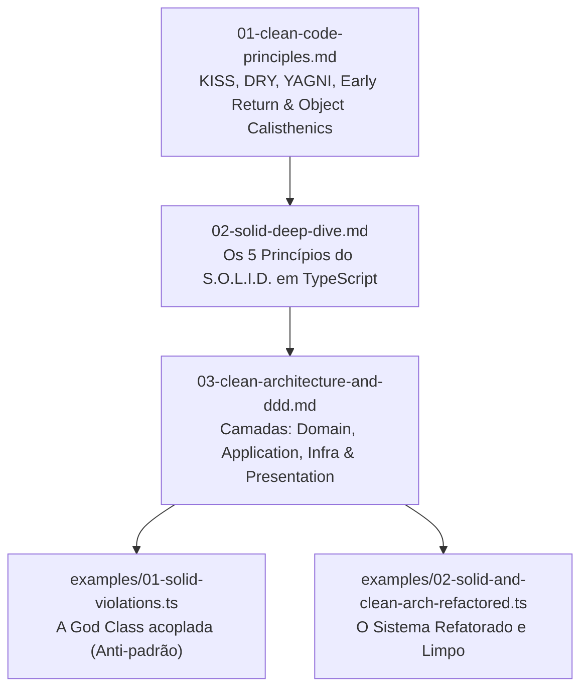

# 🏛️ Módulo 03: Arquitetura de Software, Clean Code & SOLID

> **"Qualquer tolo pode escrever código que um computador entenda. Bons programadores escrevem código que humanos podem entender."** — *Martin Fowler*

Aprender a sintaxe do TypeScript é apenas o primeiro passo. O verdadeiro divisor de águas entre um digitador de código e um **Engenheiro de Software de Elite** é a capacidade de desenhar sistemas modulares, desacoplados, fáceis de testar e prontos para evoluir ao longo dos anos.

---

## 🗺️ Mapa de Aprendizado do Módulo



---

## 📚 Estrutura das Aulas Teóricas

| Arquivo | Tópico Central | Fundamentos Abordados |
| :--- | :--- | :--- |
| **[`01-clean-code-principles.md`](./01-clean-code-principles.md)** | Filosofia de Código Limpo | KISS, DRY com moderação, YAGNI, Early Return Guard Clauses, Regras do Object Calisthenics e Naming em Inglês. |
| **[`02-solid-deep-dive.md`](./02-solid-deep-dive.md)** | Os 5 Princípios S.O.L.I.D. | SRP, OCP, LSP, ISP e DIP explicados com comparações visuais de código Ruim ❌ vs código Limpo ✅. |
| **[`03-clean-architecture-and-ddd.md`](./03-clean-architecture-and-ddd.md)** | Arquitetura Limpa & DDD | A Regra da Dependência, Entidades Ricas vs Modelos Anêmicos, Casos de Uso, Ports & Adapters. |

---

## 🧪 Laboratórios Práticos Executáveis

Neste módulo, você tem à disposição dois códigos completos que contam uma história de refatoração:

```bash
# 1. Veja o que NÃO fazer (God Class acoplada violando todos os princípios)
npm run play:solid:violations

# 2. Veja o mesmo fluxo refatorado com SOLID e Clean Architecture impecáveis
npm run play:solid
```

