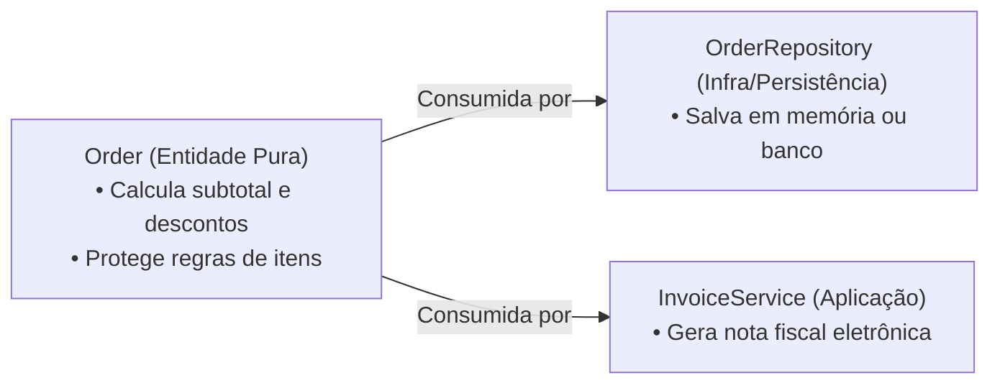

# Estudo de Caso 01: Modelagem de Domínio Comercial (`mini-seller`)

> **Repositório de Referência**: [`https://github.com/ChristopherMarques/mini-seller`](https://github.com/ChristopherMarques/mini-seller)  
> **Foco Primário**: Modelagem de Domínio Comercial, Invariantes, Imutabilidade e Single Responsibility Principle (SRP).

---

## 🎯 1. O Desafio de Negócio

No ecossistema de e-commerce e vendas, pequenas falhas conceituais geram perdas financeiras astronômicas:
* Vender produtos sem estoque suficiente (over-selling).
* Permitir descontos que ultrapassam o valor total do pedido gerando faturas negativas.
* Mutações acidentais em itens de pedidos após a finalização da compra.

O projeto **`mini-seller`** foi desenhado para resolver esses problemas através de **Modelagem Rica de Domínio (DDD)** orientada a TypeScript.

---

## 🔬 2. Dissecação da Arquitetura do Domínio

### A. A Entidade `Product` e suas Invariantes de Estoque

Em vez de permitir que camadas externas façam `product.stock = product.stock - 1`, o `mini-seller` encapsula a operação:

```typescript
export class Product {
  private _stockQuantity: number;

  constructor(
    public readonly id: string,
    public readonly name: string,
    public readonly priceInCents: number,
    initialStock: number
  ) {
    if (priceInCents <= 0) {
      throw new Error("O preço do produto deve ser estritamente positivo.");
    }
    if (initialStock < 0) {
      throw new Error("O estoque inicial não pode ser negativo.");
    }
    this._stockQuantity = initialStock;
  }

  public get stockQuantity(): number {
    return this._stockQuantity;
  }

  public decreaseStock(amount: number): void {
    if (amount <= 0) {
      throw new Error("A quantidade de baixa deve ser positiva.");
    }
    if (this._stockQuantity < amount) {
      throw new Error(`Estoque insuficiente para '${this.name}'. Disponível: ${this._stockQuantity}`);
    }
    this._stockQuantity -= amount;
  }
}
```

### B. Proteção contra o "Negative Invoice Bug" na Entidade `Order`

```typescript
export class Order {
  constructor(
    public readonly id: string,
    private readonly items: ReadonlyArray<OrderItem>,
    private readonly discountInCents: number = 0
  ) {
    if (items.length === 0) {
      throw new Error("Um pedido deve possuir ao menos um item.");
    }
    if (discountInCents < 0) {
      throw new Error("O desconto não pode ser negativo.");
    }
  }

  public getSubtotal(): number {
    return this.items.reduce((sum, item) => sum + item.unitPrice * item.quantity, 0);
  }

  public getTotal(): number {
    const subtotal = this.getSubtotal();
    // Proteção matemática: total final NUNCA pode ser menor que zero!
    return Math.max(0, subtotal - this.discountInCents);
  }
}
```

---

## 🏛️ 3. O Princípio SOLID em Destaque: SRP (Single Responsibility)

No `mini-seller`, a classe `Order` **não sabe salvar dados**, **não monta consultas SQL** e **não emite cupons fiscais**.



Cada classe possui uma **única razão para mudar**. Se o governo alterar o formato do XML da nota fiscal, a entidade `Order` permanece 100% inalterada.

---

## 🥊 4. Desafio Prático: Implementando o `CustomerCreditLedger`

Agora é a sua vez de exercitar!

### Enunciado do Desafio
Implemente uma classe de domínio chamada `CustomerCreditLedger` com as seguintes regras de negócio estritas:
1. Deve possuir: `customerId: string`, `creditLimit: number` e um saldo atual privado `_currentBalance: number` (iniciando em 0).
2. Método `charge(amount: number): void`:
   * Não aceita valores negativos ou zero.
   * Lança erro caso `_currentBalance + amount > creditLimit` ("Limite de crédito excedido").
   * Incrementa o saldo devedor.
3. Método `payOff(amount: number): void`:
   * Não aceita valores negativos ou zero.
   * Não permite pagar mais do que a dívida atual (`amount > _currentBalance`).
   * Reduz o saldo devedor.
4. Escreva 100% do código em Inglês com comentários didáticos em Português.

