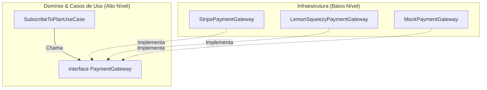

# Estudo de Caso 04: Arquitetura SaaS Full-Stack (`saas-boilerplate`)

> **Repositório de Referência**: [`https://github.com/ChristopherMarques/saas-boilerplate`](https://github.com/ChristopherMarques/saas-boilerplate)  
> **Foco Primário**: Arquitetura Full-Stack, Multi-tenancy, Autenticação, Dependency Inversion Principle (DIP) e Escala.

---

## 🎯 1. O Desafio de um SaaS Multi-Tenant Real

Construir um SaaS para milhares de clientes empresariais (B2B) impõe desafios rigorosos:
* **Isolamento de Dados**: A Empresa A jamais pode enxergar os dados ou pedidos da Empresa B.
* **Troca de Provedores**: A capacidade de trocar o gateway de pagamentos (Stripe, Pagar.me, LemonSqueezy) ou o provedor de e-mails (Resend, SendGrid) sem reescrever o sistema.
* **Testabilidade**: Testar jornadas completas de onboarding e faturamento sem disparar cobranças reais em cartão de crédito.

O projeto **`saas-boilerplate`** resolveu esses desafios aplicando **Clean Architecture** e o **Dependency Inversion Principle (DIP)**.

---

## 🔬 2. Dissecação da Inversão de Dependência em Pagamentos

Em vez de importar o SDK da Stripe dentro do Caso de Uso de Assinatura:

```typescript
// 1. O Contrato Puro (na Camada de Aplicação / Domínio)
export interface PaymentGateway {
  createSubscription(
    customerEmail: string,
    planId: string
  ): Promise<{ subscriptionId: string; status: "active" | "trialing" }>;
  cancelSubscription(subscriptionId: string): Promise<boolean>;
}

// 2. O Caso de Uso depende apenas da abstração:
export class SubscribeToPlanUseCase {
  constructor(
    private readonly paymentGateway: PaymentGateway,
    private readonly tenantRepository: TenantRepository
  ) {}

  public async execute(tenantId: string, planId: string): Promise<void> {
    const tenant = await this.tenantRepository.findById(tenantId);
    if (!tenant) throw new Error("Tenant não localizado.");

    const result = await this.paymentGateway.createSubscription(tenant.billingEmail, planId);
    tenant.updateSubscriptionStatus(result.subscriptionId, result.status);
    await this.tenantRepository.save(tenant);
  }
}
```

Na pasta de infraestrutura, criamos o adaptador real da Stripe e o adaptador falso para testes:

```typescript
// Adaptador de Teste (Executa em 2 milissegundos sem conexão de rede)
export class MockPaymentGateway implements PaymentGateway {
  public async createSubscription(customerEmail: string, planId: string) {
    return { subscriptionId: `sub_mock_${Date.now()}`, status: "active" as const };
  }
  public async cancelSubscription() { return true; }
}
```

---

## 🏛️ 3. O Princípio SOLID em Destaque: DIP (Dependency Inversion)

O diagrama abaixo ilustra o fluxo de controle versus o fluxo de dependência:



O fluxo de dependência aponta para **dentro**, garantindo que o seu modelo de negócio seja imune às mudanças de bibliotecas de terceiros.

---

## 🥊 4. Desafio Prático: Decorador de Repositório Multi-Tenant

### Enunciado do Desafio
Implemente uma classe `TenantScopedRepository<T extends { tenantId: string }>`:
1. Recebe no construtor um repositório genérico base `Repository<T>` e o `currentTenantId: string`.
2. Método `save(entity: T): Promise<void>`:
   * Verifica se `entity.tenantId === this.currentTenantId`. Se for diferente, lança erro de segurança ("Tenant mismatch violation").
   * Salva no repositório base.
3. Método `findById(id: string): Promise<T | null>`:
   * Busca no repositório base.
   * Se a entidade encontrada pertencer a outro tenant, retorna `null` silenciosamente (garantindo que um tenant nunca descubra se um ID de outro existe).

