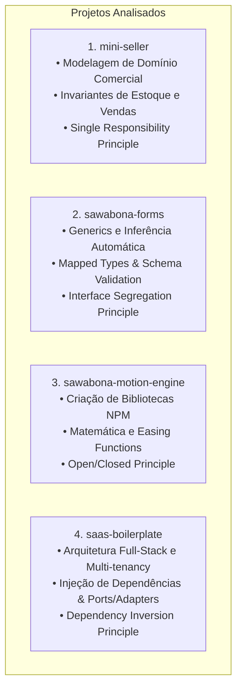

# 🔬 Módulo 04: Estudos de Caso Reais & Engenharia Reversa

> **"Ler bom código é tão importante para um engenheiro de software quanto ler boa literatura é para um grande escritor."**

Neste módulo, realizamos engenharia reversa profunda em **quatro projetos reais de código aberto** desenvolvidos pelo autor ([Christopher Marques](https://github.com/ChristopherMarques)). Cada repositório foi escolhido cirurgicamente por exemplificar um conjunto específico de desafios de arquitetura, tipagem e padrões de projeto.

---

## 🧭 O Quadrante de Estudos de Caso

---

## 📂 Visão Geral dos Estudos de Caso

| Estudo de Caso | Repositório Original | Foco Técnico Principal |
| :--- | :--- | :--- |
| **[`01-mini-seller-domain-modeling.md`](./01-mini-seller-domain-modeling.md)** | [`mini-seller`](https://github.com/ChristopherMarques/mini-seller) | Entidades Ricas vs Anêmicas, Invariantes de Estoque, Modelagem de Domínio Comercial e SRP. |
| **[`02-sawabona-forms-generics-and-isp.md`](./02-sawabona-forms-generics-and-isp.md)** | [`sawabona-forms`](https://github.com/ChristopherMarques/sawabona-forms) | Como construir bibliotecas de formulário com Generics de alta ordem, inferência de schema e ISP. |
| **[`03-motion-engine-ocp-and-contracts.md`](./03-motion-engine-ocp-and-contracts.md)** | [`sawabona-motion-engine`](https://github.com/ChristopherMarques/sawabona-motion-engine) | Engines de animação, design de APIs fluentes para NPM, física matemática e extensibilidade via OCP. |
| **[`04-saas-boilerplate-clean-fullstack.md`](./04-saas-boilerplate-clean-fullstack.md)** | [`saas-boilerplate`](https://github.com/ChristopherMarques/saas-boilerplate) | Clean Architecture corporativa, isolamento multi-tenant, autenticação segura e DIP em escala real. |

---

## 🛠️ Como Estudar Este Módulo

Cada aula deste módulo é estruturada em 4 partes essenciais:
1. **O Desafio do Mundo Real**: Qual dor técnica o projeto resolveu?
2. **Dissecação do Código e Arquitetura**: Análise linha por linha das escolhas estruturais.
3. **Padrão SOLID em Destaque**: Qual letra do SOLID o projeto mais honra e por quê?
4. **Desafio Prático (Code Challenge)**: Um exercício com requisitos claros para você codificar no terminal e testar seus conhecimentos.

