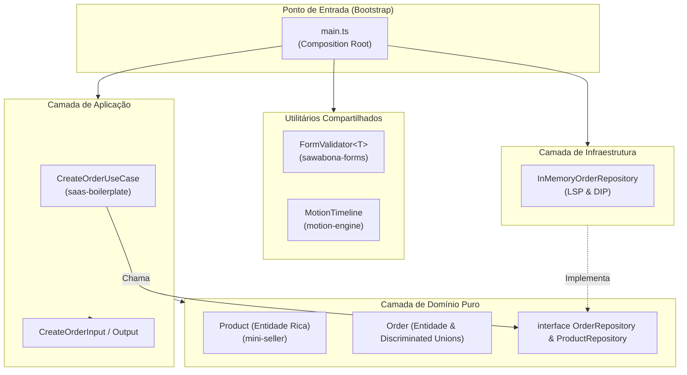

# 🛠️ Módulo 05: Projeto Prático Hands-On (Clean Architecture & SOLID)

> **"A teoria sem a prática é vazia; a prática sem a teoria é cega."**

Bem-vindo ao projeto prático do **TypeScript Hub**! Aqui colocamos em marcha tudo o que foi estudado nos módulos anteriores, criando um mini-sistema comercial completo, modular, estritamente tipado sob `"strict": true` e sem nenhuma dependência de `any`.

---

## 🏛️ A Arquitetura do Mini-Sistema

O sistema foi estruturado seguindo rigorosamente os preceitos de Clean Architecture e SOLID, utilizando como referência direta os quatro repositórios reais do autor:



---

## 📂 Arquitetura de Pastas e Responsabilidades

```text
05-hands-on-project/
├── README.md                                    # Este guia completo do projeto
└── src/
    ├── domain/                                  # 1. DOMÍNIO PURO
    │   ├── entities/Product.ts                  # Entidade rica com encapsulamento de estoque (estilo mini-seller)
    │   ├── entities/Order.ts                    # Entidade de pedido, cálculo de descontos e Discriminated Unions
    │   └── repositories/OrderRepository.ts      # Interfaces puras de persistência (DIP)
    ├── shared/                                  # 2. UTILITÁRIOS REUTILIZÁVEIS
    │   ├── FormValidator.ts                     # Motor genérico de validação <TData> (estilo sawabona-forms)
    │   └── MotionTimeline.ts                    # Linha do tempo visual e interpolação no terminal (estilo motion-engine)
    ├── application/                             # 3. CAMADA DE APLICAÇÃO
    │   ├── dtos/CreateOrderInput.ts             # DTOs de entrada e saída tipados
    │   └── use-cases/CreateOrderUseCase.ts      # Caso de uso orquestrando validação, estoque e persistência
    ├── infra/                                   # 4. CAMADA DE INFRAESTRUTURA
    │   └── repositories/InMemoryOrderRepository.ts # Adaptador concreto em memória (respeitando LSP)
    └── main.ts                                  # 5. BOOTSTRAP / COMPOSITION ROOT
```

---

## 🚀 Como Executar o Projeto no Terminal

Para ver o sistema funcionando com animação visual no terminal e validação passo a passo:

```bash
# Executa o projeto completo
npm run start:project

# Ou diretamente via tsx:
npx tsx 05-hands-on-project/src/main.ts
```

---

## 🎬 O que Acontece Durante a Execução?

Quando você roda `npm run start:project`, o script `main.ts` orquestra uma história de negócio completa:

1. **Etapa 1 (Validação com FormValidator)**:
   * Submete primeiro um payload com e-mail inválido e lista de itens vazia.
   * O `FormValidator` barra a requisição e exibe mensagens de erro amigáveis no console.
   * Em seguida, submete um payload 100% válido que passa com sucesso.

2. **Etapa 2 (Catálogo e Invariantes com Product)**:
   * Cria produtos (`Teclado Mecânico` e `Cabo USB-C`) com preços válidos e estoques iniciais.
   * As regras invariantes de negócio impedem preços negativos ou estoque inconsistente.

3. **Etapa 3 (Injeção de Dependências)**:
   * Cria os repositórios em memória e os injeta no construtor do `CreateOrderUseCase` via interfaces puras.

4. **Etapa 4 (Motion Timeline & Processamento do Pedido)**:
   * O `MotionTimeline` renderiza barras animadas no console simulando as etapas fiscais e de reserva com curvas de interpolação matemática (`easeOutQuad`, `easeInOutCubic`).
   * O pedido é persistido e o estoque dos produtos é decrementado atomicamente.
   * O console imprime o recibo final formatado com o desconto aplicado via Strategy Pattern!

---

## 🧪 Verificação de Tipos Estrita

Para comprovar que todo o projeto compila sem erros, rode a qualquer momento:

```bash
npm run typecheck
```

