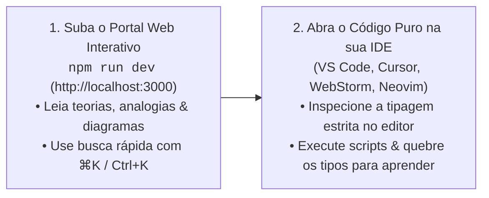
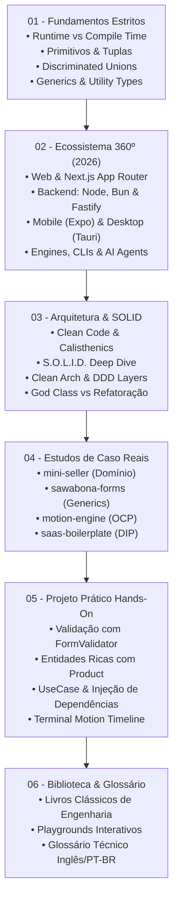

# ⚡ TypeScript Hub

<div align="center">


<p align="center">
  <strong>Academia prática e enciclopédia definitiva de TypeScript, Clean Architecture e Princípios SOLID.</strong><br/>
  Do <em>Zero Absoluto</em> à construção de arquiteturas de software desacopladas, testáveis e prontas para produção internacional em 2026.
</p>

</div>

---

## 🧭 Sobre o Projeto

O **`typescript-hub`** não é apenas mais um tutorial superficial de sintaxe. Trata-se de uma **escola viva de engenharia de software** construída sob dois princípios inegociáveis:

1. **Padrão de Mercado Internacional**: 100% do código (classes, funções, variáveis, arquivos `.ts`) é escrito em **Inglês técnico impecável**, enquanto 100% da documentação e comentários didáticos são em **Português claro e acolhedor**.
2. **Engenharia Reversa de Repositórios Reais**: Todo o conteúdo é ancorado em quatro repositórios open-source do autor ([Christopher Marques](https://github.com/ChristopherMarques)):
   * 📝 [**`sawabona-forms`**](https://github.com/ChristopherMarques/sawabona-forms): Generics de alta ordem, inferência de schemas e *Interface Segregation Principle (ISP)*.
   * 🎬 [**`sawabona-motion-engine`**](https://github.com/ChristopherMarques/sawabona-motion-engine): Engines gráficas para NPM, matemática de interpolação, keyframes e *Open/Closed Principle (OCP)*.
   * 🛍️ [**`mini-seller`**](https://github.com/ChristopherMarques/mini-seller): Modelagem de Domínio Comercial, invariantes de estoque e *Single Responsibility Principle (SRP)*.
   * 🚀 [**`saas-boilerplate`**](https://github.com/ChristopherMarques/saas-boilerplate): Arquitetura Full-Stack, isolamento multi-tenant e *Dependency Inversion Principle (DIP)*.

---

## 🎯 Fluxo de Aprendizado Recomendado (Como Estudar)

Para absorver ao máximo a profundidade teórica e a elegância arquitetural deste repositório, recomendamos uma experiência em dois passos:



> [!TIP]
> **Passo 1: Estude no Navegador**  
> Execute `npm run dev` e acerte o foco no conteúdo. A interface web estilo Mintlify foi feita sob medida para leitura limpa, busca rápida com `⌘K` / `Ctrl+K`, visualização de tabelas comparativas e índice "Nesta Página".
>
> **Passo 2: Pratique na sua IDE de Preferência**  
> Após ler a aula e entender a teoria, abra os arquivos `.ts` diretamente no seu editor de código. Sinta a inteligência do Language Server Protocol (LSP), passe o mouse sobre os Generics, tente passar argumentos errados de propósito para ver o compilador barrando e execute os scripts pelo terminal integrado (`npm run play:basics`, `npm run start:project`)!

---

## 🗺️ Trilha de Formação e Mapa Mental



---

## 📂 Estrutura Curada dos Módulos

| Módulo | Descrição do Conteúdo | Laboratório / Código |
| :--- | :--- | :--- |
| **[`01-fundamentals/`](./01-fundamentals/)** | Por que TypeScript existe, segurança em tempo de compilação, imutabilidade, contratos com `interface`, afunilamento de tipos (*narrowing*) e parâmetros genéricos `<T>`. | [`01-primitives-and-unions.ts`](./01-fundamentals/playground/01-primitives-and-unions.ts)<br/>[`02-generics-in-practice.ts`](./01-fundamentals/playground/02-generics-in-practice.ts)<br/>[`03-discriminated-unions.ts`](./01-fundamentals/playground/03-discriminated-unions.ts) |
| **[`02-ecosystem-and-platforms/`](./02-ecosystem-and-platforms/)** | Onde o TypeScript opera em 2026: Frontend unificado (React 19/Next.js Server Actions), Backends modernos (Node/Bun/Deno), Mobile (Expo), Desktop (Tauri/Electron) e AI Agents via MCP. | Guias conceituais com exemplos integrados |
| **[`03-architecture-and-solid/`](./03-architecture-and-solid/)** | Princípios de Clean Code, Object Calisthenics, S.O.L.I.D. completo com comparações visuais e Clean Architecture com Domain-Driven Design (DDD). | [`01-solid-violations.ts`](./03-architecture-and-solid/examples/01-solid-violations.ts)<br/>[`02-solid-and-clean-arch-refactored.ts`](./03-architecture-and-solid/examples/02-solid-and-clean-arch-refactored.ts) |
| **[`04-case-studies/`](./04-case-studies/)** | Engenharia reversa em 4 repositórios open-source reais com dissecação de arquitetura e desafios de código práticos para o aluno resolver. | 4 Desafios Práticos com enunciados completos |
| **[`05-hands-on-project/`](./05-hands-on-project/)** | Tutorial passo a passo e implementação de ponta a ponta de um mini-sistema comercial completo com validação de schemas, entidades ricas, Casos de Uso e linha do tempo animada. | [`main.ts`](./05-hands-on-project/src/main.ts) (Bootstrap completo com Composition Root) |
| **[`06-library-books-and-assets/`](./06-library-books-and-assets/)** | Curadoria dos melhores livros técnicos do mundo (Fowler, Martin, Evans, Vanderkam), ferramentas de AST e o **Glossário Técnico Inglês/Português**. | [`typescript-english-glossary.md`](./06-library-books-and-assets/typescript-english-glossary.md) |

---

## ⚡ Guia de Execução Rápida

O repositório já está configurado com scripts prontos para rodar em qualquer sistema operacional:

### 1. Clonar e Instalar Dependências
```bash
git clone https://github.com/ChristopherMarques/typescript-hub.git
cd typescript-hub
npm install
```

### 2. Iniciar o Portal Web de Documentação (Estilo Mintlify 🚀)
```bash
# Inicia a aplicação web de documentação interativa
npm run dev

# Abra http://localhost:3000 no navegador!
# Recursos: Busca Full-Text instantânea (⌘K / Ctrl+K), leitor de código syntax highlighted,
# índice da página, cópia com 1 clique e menu lateral responsivo.

# Para compilar a build estática de produção:
npm run build:docs
```

### 3. Checagem Estrita de Tipagem (Zero Erros)
```bash
npm run typecheck
```

### 4. Rodar os Laboratórios Interativos no Terminal
```bash
# Fundamentos: Primitivos, Tuplas, Imutabilidade e Const Assertions
npm run play:basics

# Generics: Motor de validação inspirado no sawabona-forms
npm run play:generics

# Máquina de Estados: Discriminated Unions inspiradas no motion-engine
npm run play:unions

# Anti-padrão: Executar a God Class acoplada que viola o SOLID
npm run play:solid:violations

# Clean Code: Executar o mesmo sistema 100% refatorado com SOLID
npm run play:solid
```

### 4. Executar o Projeto Hands-On Completo
```bash
npm run start:project
```

### 5. Executar Toda a Suíte de Verificação
```bash
npm run test:all
```

---

## 🏛️ Destaques da Implementação

### 1. Zero `any` e Rigor Máximo
O arquivo [`tsconfig.json`](./tsconfig.json) possui `"strict": true`, `"noImplicitAny": true`, `"noUncheckedIndexedAccess": true` e cada opção é minuciosamente explicada em português. Nenhum arquivo `.ts` faz concessões frouxas de tipo.

### 2. Clean Architecture & DDD no Projeto Prático
O mini-sistema comercial em [`05-hands-on-project/src/`](./05-hands-on-project/src/) demonstra na prática:
* **Domínio Rico**: A entidade `Product` encapsula a regra de negócio para que o estoque jamais fique negativo.
* **Discriminated Unions**: A entidade `Order` gerencia seu ciclo de vida (`PENDING_PAYMENT` ➔ `PAID` ➔ `SHIPPED` ou `CANCELLED`) impossibilitando estados ilegais.
* **Inversão de Dependência (DIP)**: O `CreateOrderUseCase` depende apenas da interface abstrata `OrderRepository`, permitindo trocar memória por Postgres sem alterar o caso de uso.
* **Feedback Visual**: O componente `MotionTimeline` desenha o progresso das etapas no terminal com interpolação de easing.

---

## 📖 Livros de Referência Recomendados

* 📘 **Effective TypeScript** — Dan Vanderkam
* 📗 **Clean Architecture** — Robert C. Martin (Uncle Bob)
* 📙 **Refactoring: Improving the Design of Existing Code** — Martin Fowler
* 📕 **Domain-Driven Design** — Eric Evans
* 📓 **Programming TypeScript** — Boris Cherny

---

## 👤 Autor e Licença

Desenvolvido com excelência técnica por **[Christopher Marques](https://github.com/ChristopherMarques)**.  
Distribuído sob a licença [MIT](./package.json). Sinta-se à vontade para utilizar, estudar e compartilhar!

